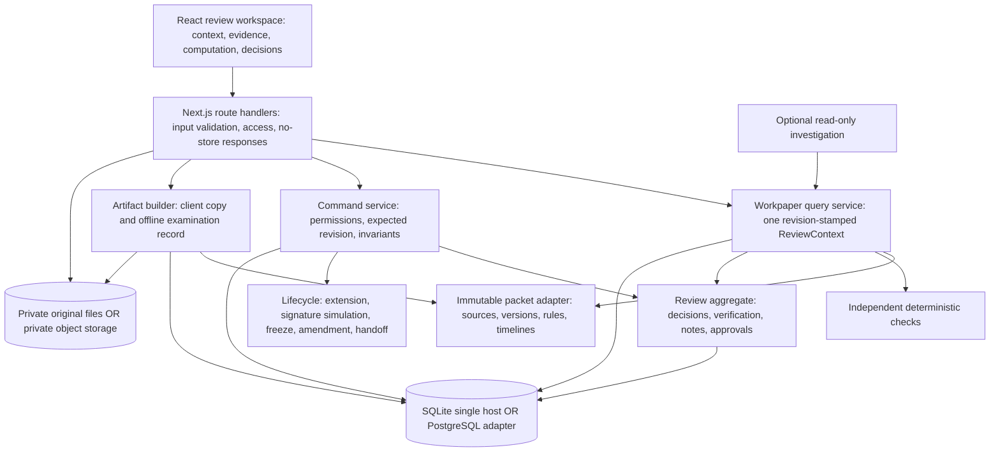

# Agent 2: architecture proposal and feature attestation

Review date: October 24, 2026, America/Chicago. Updated after Round 3 backend and assurance rebuttals. This is a design review, not an implementation or deployment. The sole authoritative product scope is the three-page [case study](/Users/rajendrathalluru/Documents/Presentation/Case_Study_Redesign_the_Tax_Workpaper%20%281%29.pdf), read in full and visually inspected. `CASE_STUDY_BRAIN.md` and the 105-ID audit are useful indexes, not proof of compliance. I inspected current domain, workflow, repository, database, packet, upload and package code, the local Next.js guides and saved UI evidence; then read the completed backend/assurance reports, consolidated blueprint and current examination-export route. I did not rerun tests or observe fresh browser sessions in this round.

## Recommendation and the decision it serves

Retain Next.js, React and TypeScript as a **modular monolith with a transactionally saved review record**, and improve the product around one coherent review workspace. Treat the workpaper as a chain of accountable claims: source observation, extracted reading, supplied computation, independent check, human decision and signed review. A reviewer should be able to inspect that chain without navigating a collection of disconnected administration screens.

All case-study features stay in scope. The assignment is one household, starts after extraction and supplies the computed return. No PDF requirement calls for OCR, a replacement tax engine, microservices, a vector database or autonomous agents making tax decisions. Design a packet-adapter boundary so supplied data is not entangled with presentation; do not spend the submission rebuilding an upstream extraction platform.

The present implementation already contains substantial domain behavior worth preserving. A framework/backend rewrite would consume time without proving a better workpaper. The best submission combines this foundation with excellent source focus, visible provenance and review state, reliable save/conflict handling, coherent navigation and an applicant explanation of real tradeoffs.

## Stack and credible alternatives

| Concern | Recommended assignment choice | Reason and boundary |
|---|---|---|
| UI and server | Existing locked Next.js App Router + React + TypeScript | One language and deployment; server route handlers are sufficient. Local inspected versions are Next 16.3.4 and React 19.2.6, not a claim about the newest releases. Keep interactive review panels client-side and packet/private data server-side. |
| Visual system | Existing custom CSS with named spacing/color/type tokens, lucide icons and accessible interaction primitives | Preserve the restrained professional identity. Spend effort on information hierarchy, source/line alignment, keyboard use, comparison and responsive evidence panels. A new design-system dependency is optional; accessibility behavior is mandatory. |
| Validation | Typed domain commands plus a runtime schema at each request/import boundary | TypeScript alone cannot validate external input. Zod already exists in the dependency set; a schema is proposed where checks are currently manual. |
| Assignment persistence | SQLite WAL + private files on one durable host, with a verified patched embedded SQLite runtime, backups and a protected demo access gate | Sufficient for one small engagement and a few concurrent reviewers. The current adapter already commits a compare-and-swap plus related metadata atomically; hosted runtime and restore proof remain open. |
| Hosted multi-instance alternative | PostgreSQL + private object storage behind the same repository/blob interfaces | Prefer when the selected host is ephemeral or multiple instances are required. This is a deployment-dependent adapter choice, not a reason to rewrite domain logic. |
| Query/search | Indexed in-memory packet projections and database-backed review records | Roughly 3,000 supplied values and hundreds of sales do not justify search infrastructure. Use filters/grouped summaries/pagination before adding virtualization. |
| Collaboration | Revision polling with visible freshness and optimistic concurrency | Two people can work without silent overwrites. A stale write needs an understandable conflict view. WebSockets/presence are an optional latency improvement. |
| AI | Optional bounded, read-only investigation with citations; deterministic checks always available | Useful for navigating evidence and proposing investigation, not authoritative verification, arithmetic, sign-off or filing. The five reviewing agents are a development method, not five production services. |
| Verification | Domain invariants, API/transaction tests, browser task tests and observed CPA/new-hire use | A passing implementation-shaped unit test is not evidence that the workpaper is faster or understandable. |

Next.js officially supports full-feature Node and Docker deployment, while static export omits server-dependent features. A GitHub repository or GitHub Pages upload does not supply this app's persistence/API runtime. [Next.js deployment guide](https://nextjs.org/docs/app/getting-started/deploying)

**Credible alternative: React/Vite plus FastAPI and PostgreSQL.** This is sensible for a Python-heavy tax/analytics team or an independently developed API, and still satisfies the PDF. Here it adds two runtimes, request/schema duplication, CORS/session seams, separate deployment and a rewrite of tested TypeScript domain behavior. The supplied engine does not need a Python implementation. I reject the rewrite for this submission, not the stack generally.

**Credible alternative: PostgreSQL from the first hosted demo.** This improves fit with stateless hosting and operational backups, and I prefer it over local SQLite on an ephemeral/serverless filesystem. It requires implementing and testing a PostgreSQL repository rather than claiming that an existing SQLite SQL wrapper automatically works unchanged. Both options retain the same logical model.

**Rejected architectural expansion: microservices plus an agent orchestrator.** Review edits, invalidation and freeze are one consistency problem. Splitting them creates distributed transaction/retry concerns before there is an independent scale or ownership requirement. A queue/worker becomes justified by measured long-running exports, malware scanning or production notifications, not by current trends.

## Component diagram and boundaries

The diagram shows logical modules within one server, not independently deployed services. Current mappings are `lib/packet.ts`, `records.ts`, `checks.ts`, `search.ts`, `domain.ts`, `workflow.ts`, `repository.ts`, `database.ts`, `local-storage.ts`, `packages.ts`, `identifiers.ts` and `agent.ts`. Route handlers are transport, not a second source of business rules.

The **proposed query-service improvement** is a single `getReviewContext(itemRef, versionId, workspaceRevision)` projection. Its context token contains engagement/packet identity and digest, engine version, edit/workspace revision, material content revision, review cycle, frozen parent ID/hash and replay mode. Edit revision orders all saved mutations; content revision identifies the material facts approvals cover. It returns the selected stable reference; source document/page/field; printed observation; extracted reading/confidence; supplied engine line, rule and dependencies; reviewed overlays; verification and judgment records; linked questions/notes; actor permissions; readiness blockers; and changes since the viewer's last acknowledgment. Include an explicit provenance kind on every displayed amount. Existing `getBootstrap`, `getDocument`, `resolveSource` and `traceLine` provide constituents, but no unified context API was found. Compose against one loaded workspace snapshot so the client cannot accidentally compare a revision-20 approval with revision-21 adjustments. The same token and captured-state rule apply to exports, not only browser panels.

## Logical model, identities and invariants

The assignment need not normalize every record into its own table. The following is a logical model; the current SQLite implementation persists the review aggregate as JSON plus attachments, agent runs, sensitive-view logs and protected corrections.

| Entity | Identity and relationships | Invariant |
|---|---|---|
| Engagement / packet | Household + tax year + immutable packet digest | Source bytes remain unchanged. A future adapter namespaces all references by packet/engagement; current code is explicitly single-packet. |
| Document / page / extracted field | Packet + document ID + page + field ID | Stable links survive a viewer switch from simulation to original. Synthetic source positions are never represented as exact original-page geometry. |
| Engine version / line / rule | Packet + version ID + line key | Imported values and calculation dependencies are read-only. The dependency graph explains the supplied engine; it does not certify it. |
| Evidence link / verification / reconciliation | Stable target reference, method, author, time, sources, result | Confidence is not verification. A check records its named scope and independent method. Unknown facts stay unknown. |
| Decision / adjustment / batch / scenario | Target, old/new values, author, reason, sources, tax-effect type, revision | Originals and reversals remain visible. Supplied exact alternatives are isolated scenarios; estimates are not composed into an asserted corrected final tax. |
| Revision / audit event | Engagement + monotonic revision | A material mutation, audit event and approval invalidation commit together. No silent last-writer-wins. |
| Review note / question / response / assignment | Target or engagement, owner/recipient, state, deadline | Answers and discussion become evidence. Open blocking notes prevent approval/freeze; notifications are durable in-app records. |
| Sign-off / client authorization | Actor, role, content revision, cycle, scope | Changes to signed content invalidate approval; old approvals/signatures remain historical evidence. Demo personas are not verified identities. |
| Filing snapshot / attempt / amendment | Snapshot content hash, packet digest, parent snapshot, jurisdiction and cycle | Freeze deep-copies reviewed state; rejected attempts and amendments preserve parents. Agency status/signatures remain labeled simulations. |
| Original attachment / protected correction / view log | Opaque object ID, content hash, owner; actor, reason, target, time for access | Server checks access for every sensitive read. Plaintext identifiers stay out of bootstrap/search/audit/AI. |
| Standards / time / carryforward / planning | Versioned policy and source revision/year | Computed readiness follows applicable standards; handoffs preserve lineage and uncertainty. A saved plan does not claim a newly computed return. |

Hashing detects content changes; it is not proof of agency filing or resistance to an administrator who can rewrite both data and hash. Production immutable retention, external audit anchoring, KMS and real signatures are separate needs. Canonical serialization and export-schema versions should be explicit before consumers depend on cross-language hash verification.

## Request and transaction flow

1. Read the trusted access session and selected demo persona separately. Scope all reads/writes to the allowed engagement. Validate request size, schema, references and role on the server.
2. Load a revision-consistent aggregate. A command carries `expectedRevision` and, in the proposed retry-safe contract, a unique request ID tied to engagement, actor and body. A retry with the same ID/body returns the original committed outcome; reuse with different input fails. Query projections are pure reads.
3. Apply a pure domain transition: validate frozen/cycle state, original/overlay compatibility, required rationale, preparation/review separation and completeness. Bulk operations validate every selected item before creating any effects.
4. In one database transaction, compare expected revision, commit next state and audit, invalidate affected approvals, and register attachment/protected metadata. Roll back all SQL mutations if the comparison fails. The present `LocalDatabase.batch()` uses `BEGIN IMMEDIATE` and checks the update count.
5. Return the committed revision and affected references. A `409` response should include the current revision and changed-item summary. Keep the client's unsaved rationale, show the changed values and require deliberate resubmission; never silently reapply a stale financial decision.
6. Other sessions poll a lightweight revision endpoint and refresh affected contexts. Show last refreshed time, new-change indicator and failed-refresh state. Polling alone is not a save guarantee; the transaction remains authoritative. Two-session proof requires distinct cookie jars/browser sessions sharing the same engagement: ordinary tabs share the persona cookie and do not prove independent roles.

The current aggregate-wide CAS advances even for nonmaterial seen markers and time entries. That is safe against lost writes but can reject a financial draft although its selected facts did not change. Keep that safe behavior first, improve the conflict explanation and preserve the safe rationale. Separating viewer-local seen/notification state or staff activity from financial content is a later, explicit schema/transaction decision; it must not weaken content-bound approvals or introduce automatic replay of financial commands. There is no demonstrated need to normalize the entire review JSON aggregate for this assignment. Add a saved-state schema version and runtime validation before broader model changes.

SQLite WAL allows readers and a writer to proceed concurrently, but has one writer at a time and requires the same host rather than a network filesystem. Keep transactions short and never hold them while waiting for AI, rendering exports or uploading bytes. [SQLite WAL](https://sqlite.org/wal.html)

The backend reviewer freshly inspected local Node v22.15.0 with embedded SQLite 3.49.1; I did not repeat that execution. I independently checked official WAL section 11: it documents a rare multiple-connection write/checkpoint race, fixed in 3.51.3+ and specified backports 3.44.6/3.50.7. No corruption was observed here, and the current singleton limits that exposure. A selected hosted/multiprocess WAL runtime must verify its actual embedded library is patched; a package.json Node minimum does not establish that condition. This is a deployment/runtime gate, not an automatic mandate for PostgreSQL. [SQLite WAL-reset bug](https://sqlite.org/wal.html#the_wal_reset_bug)

For PostgreSQL, retain a conditional revision update or lock the engagement row within a transaction. Implement its SQL dialect, schema/migrations, driver/result behavior and asynchronous transaction adapter deliberately: the current SQLite `INSERT OR IGNORE` and wrapper shape are not a drop-in migration. Do not assume PostgreSQL eliminates application-level conflicts or requires automatic table normalization. Multi-row invariants may use stronger isolation where needed; serialization failures require retrying the complete transaction, and retried commands must be idempotent. [PostgreSQL transaction isolation](https://www.postgresql.org/docs/current/transaction-iso.html), [row locking](https://www.postgresql.org/docs/current/explicit-locking.html)

Current uploads stage bytes before the SQL commit and delete them on caught failure. A process crash between these steps can leave an orphan. A proposed small reconciliation task should remove only sufficiently old unreferenced staged objects; it must never delete referenced originals. Blob-store writes cannot honestly be described as part of the SQLite transaction.

### Export consistency: accepted assurance objection

The current examination route captures a workspace, independently selects all attachment/correction rows and asynchronously reads bytes. I confirmed this sequence in source. A concurrent later upload/correction can therefore enter an artifact absent from its declared review revision; the conditional expected-hash check currently permits a file with no hash in that selected state. This is a specific inspected race risk, not a reproduced corrupt export or a newly repaired feature.

The proposed export captures the selected live/frozen state plus **exact referenced attachment and correction IDs, immutable metadata and expected hashes** in one short database snapshot. This snapshot carries the complete context token. Read immutable blobs after releasing that transaction, require every expected hash and matching size, reject missing/unexpected evidence and fail on alteration. Include only selected historical corrections; do not silently substitute a newer correction into a frozen record. New concurrent work is either excluded by that captured manifest or triggers an explicit retry if consistency cannot be established. Export-time sensitive-view logs are separate operational events, not retroactive signed content. Add a deterministic interleaved export/upload/correction test before asserting revision-exact F07 behavior. No transaction may remain open during blob I/O or HTML generation.

## Case-feature attestation

**Status vocabulary:** `Present` means I found the mechanism in inspected code, not that I reran the feature; `Proposed` means a design change still needs implementation; `External proof` means behavior or submission evidence code cannot establish. Existing test files are candidate verification evidence only. The coordinator's fresh attestation determines final completion. No feature is waived by this architecture.

| PDF feature / baseline index | Mechanism and current file boundary | Verification criterion and honest status |
|---|---|---|
| Web-native workpaper, traceability, all personas, original UX and usability (B01-B05) | `page.tsx` + review components, role-specific domain actions and query projections | Present app/screens in code and saved screenshot; cohesive ReviewContext proposed. Time a CPA and new hire through a source discrepancy, change and review. Faster/trustworthy/day-one claims require external observed proof. |
| Exact source, reverse destinations, verification, related items/years/returns, file/message/note evidence, simulated/replaced originals (E01-E12) | `packet.ts`, `workflow.ts`, `source-viewer.tsx`, private attachment routes | Present stable field/page IDs, reverse traversal, verification/evidence-link commands and original binding. Test every reference, unused disposition, transitive destination and linked note/answer. Repeat-text source selection must not claim false precision. Original viewer geometry remains explicitly separate from simulated positions. |
| Computation, reconciliations, large sales/assets, books-to-tax, state split, engine-independent checks (C01-C07) | `traceLine`, `records.ts`, `checks.ts`, `reconcile` command | Present imported dependency traversal, grouped record projections and independent source arithmetic. Test aggregates against complete populations, a mismatching source, all-state/CA bridges and calculations not derived from the same faulty engine total. Paginated detail must retain totals/filter context. |
| Original-preserving change, live changes, since-last-seen, versions, what-ifs, bulk and undo (H01-H07) | `domain.ts`, `workflow.ts`, version projections and refresh logic | Present attributable adjustments, numeric overlays, material revisions, last-seen markers, saved scenarios, atomic batches and reversals. Fresh two-session conflict and draft-preservation task is required; richer conflict/context response proposed. Assert source hash unchanged, batch rollback, history intact and exact-scenario/estimated-effect labels distinct. |
| Prior-year swings, judgment/authority, elections, due diligence, penalties, complete documents/areas/outside filings (J01-J08) | `records.ts`, `workflow.ts`, standards and `workflowBlockers` | Present record projections, judgment categories, diligence, disposition and outside-filing registers/gates. Verify each category can be saved, sourced, reopened and found; an authority field cannot fabricate an unavailable conclusion. Administrator changes must remain attributable and cannot silently erase review history. |
| Client/colleague questions, blocking notes, reopening sign-offs, roles, concurrency, assignments/deadlines/notifications, client approval/signature (P01-P11) | `domain.ts`, `workflow.ts`, `repository.ts`, `server.ts` | Present local command enforcement, threads/tasks, notifications, content-bound approvals and simulated authorizations. Test direct unauthorized API reads/writes, same-revision concurrent writes with separate cookie jars, invalidation and both required client authorizations. Hosted trusted access/engagement scope and role-specific read DTOs are proposed; persona cookie and identifier masking alone do not prove genuine identity or client least privilege. |
| Extension, filing/rejections/corrections, client copy, freeze/amend, notice record, carryforward and planning (F01-F09) | `workflow.ts`, `packages.ts`, client/exam export routes | Present state-checked simulation, frozen snapshot, rejection-correction/new amendment cycles, client HTML, examination HTML, handoff and plans. Current examination export has the inspected mixed-revision evidence-selection gap; strict captured ID/metadata/hash manifest is proposed and needs an interleaved concurrent-export check. Also assert frozen parent unchanged, fresh approvals, invalid-transition denial and complete offline originals. Actual filing/signature is not claimed. |
| Standards, sensitive protection/view logs, time-budget, computed status, search (O01-O06) | `workflow.ts`, `identifiers.ts`, sensitive routes, `search.ts`, `packages.ts` | Present local standards/history, masked projections, encrypted identifier corrections, logged reveal/original access, time/status/search. Verify plaintext exclusion from responses/export metadata/AI, authorized reveal logs and tamper denial. Current whole-workspace masked reads do not establish role-appropriate visibility. Hosted identity/read policy, patched runtime, key management and coordinated DB/files/key restore remain deployment work. |
| Summary/prior year, computation, areas/index, all depreciation dimensions/disposals, sales, books, rentals/passive loss, K-1, retirement/foreign, deductions/credits/limits, payments/state split, carryovers/yearly basis, prior preparer/current change (R01-R23) | `records.ts`, `checks.ts`, record-tools/expanded-workspace views | Present dedicated supplied-record groups and comparison/area projections. Verify row-population completeness, links, method/life/bonus/federal/CA/AMT/disposal fields, related reconciliations and unknown basis/history. A populated generic JSON viewer alone would not attest readable CPA records. Fresh task-level UI checks remain required. |
| Delivered household complexity, late/corrected documents, 74-doc packet/confidence/three versions, answers/prior years/agency/staff, season timeline and confident mistakes (S01-S09) | Immutable packet adapter, `issues.ts`, `records.ts`, `checks.ts`, replay projection | Present fixed-case import, all versions, sources and read-only season availability context. Test corrected/superseded identities, late evidence and timeline filtering; do not pretend replay rewinds the current decision aggregate. General validated packet adapter proposed; arbitrary raw-file extraction is outside the PDF. |
| Shared link, delivered bytes, save everything, role switcher, one-page model, errors/design, applicant video and AI/tool disclosure (D01-D08) | Persistent repository, role UI and submission documents | Local persistence and packet pinning present. Shared hosted link remains unfulfilled until target/access/storage are implemented and tested. Inspect separate one-page/error/disclosure artifacts; applicant must personally record and supply video. These are mandatory submission gates, not optional production scope. |

## Hosting, resilience and the production boundary

No destination is selected and no deployment is authorized by this review. The user rejected OpenAI Sites.

**Assignment option A:** one Node/Docker service with a durable private disk holding SQLite, originals and the identifier-protection key; a real invite/access gate fronts fictional role switching. Limit to one state-owning instance, configure HTTPS, trusted proxy/host/origin handling, application limits, backup/restore and a private demo dataset. A durable disk is a hosting feature that must actually be configured. For example, Render documents default ephemeral filesystems and persistent disks for eligible paid services; only files under the mounted path persist. [Render persistent disks](https://render.com/docs/disks)

**Assignment option B:** a compatible Next.js host plus managed PostgreSQL and private object storage. Implement repository/blob adapters, keep authorization in server queries, run migrations and test network/database failures. A provider-supported PostgreSQL integration and private blob option can simplify operations, but selection requires current limits/cost review and user choice. [Vercel storage options](https://vercel.com/docs/storage)

The current server explicitly rejects non-loopback access and production access without local-preview configuration. Replacing those safeguards with `MIRAFLORES_LOCAL_PREVIEW=1` and a public bind is not deployment completion. Separate trusted evaluator access, workspace ownership and simulated personas, then replace the localhost assumptions deliberately. Keep a clear demo label for role switching and simulated agency workflow.

The current bootstrap returns the entire masked workspace to every persona. Masking identifiers protects one class of data; it does not decide whether a client may read internal review notes, judgments, tasks, audit or firm budgets. For a genuine client/team boundary, define role-specific query/search/export DTOs and enforce them on direct requests, including guessed IDs. Alternatively a controlled evaluator sandbox may deliberately permit broad fictional-role exploration, with that capability disclosed explicitly. It must not be described as real client least privilege. Access session, selected demo role and workspace ownership remain distinct. Ordinary rationale drafts are scoped to session/persona/engagement/context; sensitive corrections clear on hide/role change/timeout and are not preserved in casual browser storage. These are proposed requirements, not current verified controls.

Back up the database consistently with originals and encryption keys; perform a restore rehearsal and verify packet/snapshot/original hashes. Copying only the main SQLite file while WAL writes continue is not a backup strategy. Use a stopped consistent backup or SQLite-aware snapshot mechanism. The SQLite backup API explicitly supports creating a database snapshot while coordinating concurrent access. [SQLite backup guide](https://sqlite.org/backup.html)

Production, beyond the assignment, requires genuine identity/membership and least-privilege roles; protected session/CSRF handling; TLS; managed secrets/KMS and rotation; private storage policies; malware/content handling; retention and deletion controls; encrypted backups and tested recovery; observability without identifier leakage; append-only/tamper-evident audit controls; and integration with genuine tax/filing services if promised. These are practical boundaries, not claims that current prototype has passed compliance certification.

## Recorded objections and replies

1. **Requirements agent:** which requirement justifies services beyond a monolith? **Accepted:** none in the PDF. Kept module boundaries but rejected independent microservices. We agree supplied exact alternatives and estimated overlays cannot become a recomputed final tax claim.
2. **Frontend agent:** separate endpoints risk mixing source, engine and review revisions. **Accepted:** proposed revision-stamped ReviewContext query with readiness/blocker projection; no need to duplicate business rules in the browser.
3. **Frontend agent:** conflicts must preserve rationale rather than reset the screen. **Accepted:** proposed changed-reference `409` response and retained draft; conflict-free merging of financial changes is not assumed.
4. **Architecture challenge to frontend:** do PDF needs require WebSockets, global state infrastructure or a graph canvas? **Reply received:** no; focus-aware polling, visible freshness and CAS suffice at supplied scale if tested in two sessions. Presence must not imply locks. We agreed on isolated supplied alternatives, separate estimates and persistent frozen/amendment parent context.
5. **Frontend independent finding:** current dialogs lack full focus trapping/return and inert background despite Escape handling. **Accepted as required interaction remediation:** accessibility is not traded away for visual polish. This review did not implement that fix.
6. **Backend:** ReviewContext must distinguish edit/content revisions and include packet digest/version/cycle/frozen lineage; global CAS includes harmless activity; PostgreSQL is not a drop-in adapter. **Accepted and sent a direct reply:** expanded the complete context token and retry contract, retained safe CAS while improving explanations, deferred activity partitioning until semantics are specified, and explicitly retained the case JSON aggregate. No automatic normalization or database migration.
7. **Assurance and backend:** an exact declared export can mix later attachment/correction rows with an older captured state. **Accepted after direct route inspection and sent replies to both reviewers:** require exact referenced IDs, consistent immutable metadata snapshot and mandatory hashes, then blob I/O outside the transaction. Added deterministic interleaved-export acceptance. Current F07 completion must retain this qualification until fixed and tested.
8. **Assurance:** separate ordinary tabs share the persona cookie, and masked full-workspace bootstrap is not least privilege. **Accepted and sent a direct reply:** two-session proof needs independent cookie jars sharing one engagement. Use genuine role-specific read policy, or clearly disclose a controlled evaluator sandbox rather than claim client isolation. Actual hosted identity/access/durability remain unproven.
9. **Backend and assurance:** the local embedded SQLite version is older than the documented WAL-reset fix; restore must cover external files and identifier key. **Accepted:** independently checked official patch conditions, attributed the peer's fresh runtime observation and added the hosted patched-runtime gate. No corruption was observed, no runtime was upgraded and PostgreSQL remains conditional. Coordinated restore rehearsal remains open.

**Accepted:** modular monolith; unchanged delivered packet; all PDF feature groups; complete revision/provenance/lineage token; deterministic checks and optional read-only AI; strict manifest-based export; scoped access/read policies; independent sessions; supported patched runtime and coordinated recovery.

**Rejected for this submission:** framework/backend rewrite without a requirement; autonomous tax decisions; blanket microservices; automatic PostgreSQL/normalization; assuming hashes prove agency acceptance; removing the loopback guard as a substitute for deployment; automatically replaying stale financial commands.

**Deferred choices/work:** actual host and consequent persistence adapter, disclosed evaluator sandbox versus genuine client access model, actor-local activity partitioning, finer-grained review scopes, and optional realtime transport. All proposed fixes still require implementation and verification. Shared URL, applicant's actual video and observed CPA/new-hire usability remain open mandatory evidence.

No architecture dissent remains with the received product, frontend, backend and assurance objections. This is agreement on a design and its limitations, not proof that proposed behavior works or authority to publish. The coordinator records overall five-agent consensus only after all peer replies. The applicant still needs to demonstrate one continuous workflow from a confident source error through an attributable decision, independent review, freeze and offline handoff, while explaining the boundaries.
