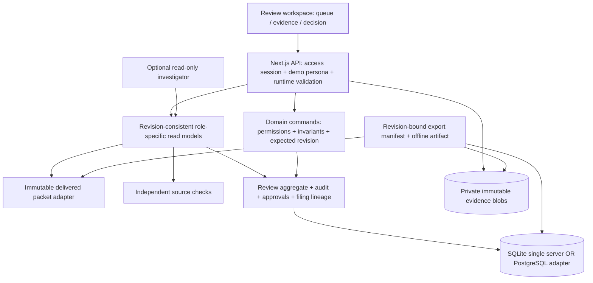
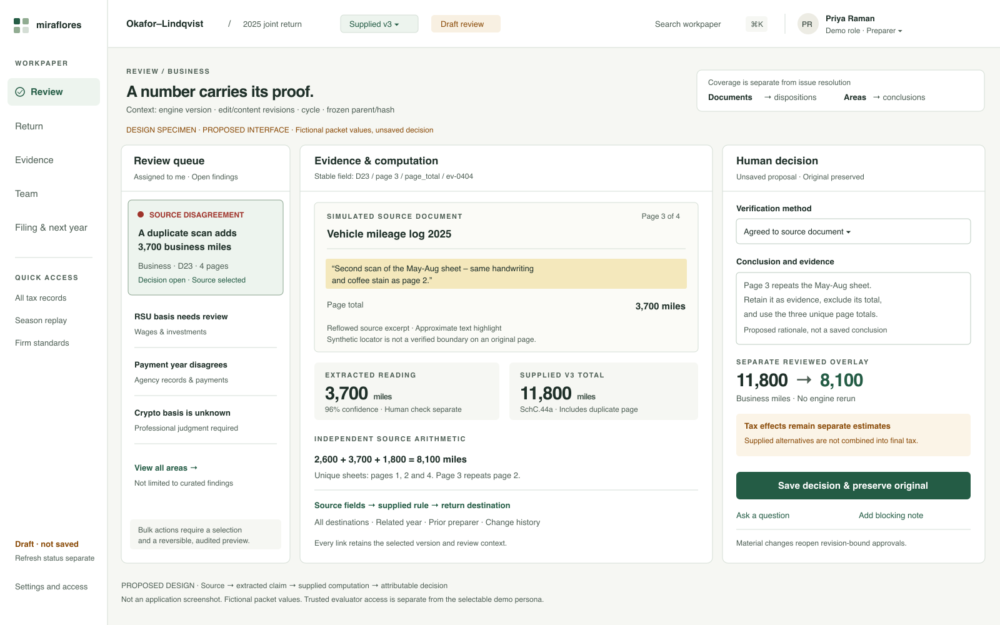

# Recommended design for the Miraflores assignment

Review date: October 24, 2026. Status: five-agent design review complete after proposals, challenges, responses and final independent assurance. All five reviewers attest that this revised blueprint retains every PDF feature; no architectural objection remains. This document describes the recommended design; it is not an implementation, deployment or new test certificate.

## The brief controls the solution

The three-page case study is the sole product specification. It asks for a complete web-native workpaper for the supplied fictional household, beginning after extraction and tax computation. Every required evidence, calculation, change, judgment, people, filing, firm and CPA-record capability remains mandatory. The app must load the delivered packet, save work, offer a role switcher and run from a shared link. The one-page explanation, errors/design account, applicant's own video link and tools/AI disclosure are also required.

The [105-row feature attestation](01-CASE-FEATURE-ATTESTATION.md) maps every indexed obligation to its PDF page, current evidence, limitations and acceptance obligation. The index is a review aid, not a replacement specification. A script checked 105 unique rows, with no missing or duplicate IDs. That is a documentation coverage check, not proof that 105 application behaviors pass.

## Recommendation

Retain the existing **Next.js + React + TypeScript modular monolith**. Organize the product around a reviewable claim: its source, supplied computation, independent check, human decision, author and unresolved work. Preserve the existing domain rules while making the review experience coherent.

Use **SQLite and private files for one durable server**, subject to a supported, patched embedded database runtime and tested backup/restore. Use **PostgreSQL and private object storage** when the selected hosting environment requires stateless or multiple application instances. Keep those implementations behind repository and blob interfaces. The actual hosting choice remains open; OpenAI Sites is excluded by the applicant's preference.

### Stack and tools

| Layer | Choice | Present or proposed |
|---|---|---|
| Application | Existing pinned Next.js App Router, React, TypeScript and Node | Present; improve module boundaries and interaction rather than rewrite frameworks |
| Visual system | CSS tokens, semantic HTML, existing Lucide icons, simple native SVG | Present foundation; proposed cohesive navigation, contextual review and domain-specific record views |
| Accessible interaction | Correct focus, keyboard, labels, inert background and draft handling; consider a targeted accessible Dialog primitive | Current custom Dialog has gaps; a new dependency is optional and must be tested in context |
| Request validation | Typed commands and runtime schemas using the installed Zod dependency | Proposed systematic boundary coverage; TypeScript does not validate incoming JSON |
| Domain | Pure commands, permission checks, revision checks, review invalidation, lifecycle transitions | Present foundation; proposed explicit schemas and richer conflict results |
| Assignment database | SQLite on one durable local disk, short transactions and a verified patched embedded runtime | Present adapter; hosted durability/runtime validation still open |
| Conditional hosted database | PostgreSQL adapter, retaining compare-and-swap and transaction invariants | Proposed alternative, not an automatic drop-in replacement |
| Original evidence | Private immutable files with content hash; private object-store adapter for stateless hosting | Local files present; storage policies and remote adapter proposed |
| Search and detail | Packet indexes, database queries, summaries, filters and paginated native tables | Present foundation; no measured need for a separate search or graph database |
| Collaboration | Visible refresh/error state, revision polling and stale-write rejection | Polling/CAS present; proposed changed-reference conflicts and preserved drafts |
| Verification | Existing domain/API suites plus browser journeys, accessibility checks and observed users | Prior tests exist; proposed UI/hosted acceptance must actually run after changes |
| AI | Optional bounded, read-only evidence investigation with stable citations and human decisions | Guided mode present; live connectivity unverified and key optional |

Next.js supports Node/Docker deployment with server features. Its self-hosting guide describes reverse proxies and deployment concerns. A source repository alone does not operate the server, database or private files. [Next.js deployment](https://nextjs.org/docs/app/getting-started/deploying), [self-hosting](https://nextjs.org/docs/app/guides/self-hosting)

SQLite permits one writer at a time, which is a reasonable fit for this small engagement when transactions are short. Its WAL documentation also specifies same-host storage and a patched-runtime requirement for the documented WAL-reset race. The backend reviewer inspected Node 22.15.0 with embedded SQLite 3.49.1; that is an observed local version, not a hosting recommendation or evidence of corruption. Verify the database actually embedded in the chosen runtime before deployment. [SQLite use cases](https://sqlite.org/whentouse.html), [SQLite WAL](https://sqlite.org/wal.html)

## Architecture

These are modules inside one server. The same transaction owns a review change, its audit and affected approval invalidation. An AI request, file transfer or HTML rendering must not hold that transaction open.

The supplied documents, pages, extracted fields, return versions, lines and rules are immutable input. Authored verification, decisions, questions, evidence links, tasks, standards and signatures live in a separate revisioned review record. Frozen filing snapshots retain parent/child lineage for corrections and amendments. Unknown basis/history remains unknown.

Retain the JSON review aggregate while it remains practical for this single engagement; give commands and projections explicit types. Normalize records when an identified query, contention or retention requirement warrants it. Moving to PostgreSQL does not remove stale-edit conflicts or automatically make a JSON model well designed. [PostgreSQL transaction isolation](https://www.postgresql.org/docs/current/transaction-iso.html)

### One consistent review context

Proposed `ReviewContext` includes engagement/packet identity and digest, item reference, supplied engine version, edit revision, material content revision, cycle, frozen parent/hash, replay mode/time, permissions, provenance, computation, saved decisions, verification, blockers and unread changes. Compose it from one captured workspace state; do not assemble incompatible revisions from unrelated browser requests. Historical replay filters available evidence without backdating today's decisions.

Every mutation carries the expected edit revision and an actor/body-bound request identity for deliberate retry handling. A conflict returns current context and changed references. Preserve safe ordinary rationale in the same context; show the competing values; require explicit resubmission. Distinguish an unrelated activity revision from a change to the reviewed facts. Retain the safe global compare-and-swap now. Separating activity/read markers from the aggregate is deferred until its semantics and tests are specified, preserving content-bound approvals.

An interrupted response can leave a commit outcome unknown. Show that state and reconcile using the request identity before allowing a deliberate retry; never automatically replay a financial decision. Idempotency and richer conflict replies are proposed contracts, not current behavior.

An export captures the exact state plus attachment/correction IDs and metadata consistently, then reads immutable bytes outside the database transaction. Every included file must have an expected hash in that manifest. Newer files cannot enter an older declared revision; missing or altered bytes fail export. The current route has a code-level race risk because it reads those lists separately and permits files without an expected hash. No concurrent failure was reproduced in this design review.

### Access and storage

The current localhost owner/persona cookie is an explicitly local simulation. The masked bootstrap includes the whole review workspace. Before claiming real client/team isolation, define role-specific read models and enforce them on every API and export. For a shared evaluator sandbox, separate trusted entry/access from fictional role selection and disclose what the sandbox demonstrates.

Store identifiers and originals privately; keep corrected identifier plaintext out of bootstrap, ordinary logs, search and AI. Sensitive export/reveal is authorized and logged. Recover database, original bytes and protection keys together, and rehearse restoration. Reconcile sufficiently old unreferenced staged files after crashes. Hashes detect changes against trusted expected metadata; they do not establish agency acceptance or protection against a privileged administrator rewriting the database.

## Frontend design

Use five primary destinations: **Review, Return, Evidence, Team, Filing & next year**. Global search and administration remain reachable. The complete feature set stays accessible through contextual actions and secondary views.

At desktop size, keep the work queue, source/computation and decision visible together. Keep household, tax year, supplied version, edit/material-content revisions, demo role, replay mode and draft/frozen/amendment parent context visible. Source page and field IDs remain stable; synthetic coordinates and approximate highlights remain labeled. A financial amount carries a visible provenance and review-status affordance.

Track draft state, save outcome and refresh freshness separately: Draft, Saving, Saved at revision X, Save failed with safe draft retained, Commit outcome uncertain, Changes available and Refresh unavailable have different meanings. Preserve ordinary rationale in memory under its access-session/persona/engagement/item context across polling and conflict comparison. A role/context change must never reveal another context's draft; use an explicit discard/save choice where appropriate. Protected identifier plaintext clears on hide, timeout, dismissal, conflict or role/session change, is never restored as an ordinary draft and never enters normal browser persistence.

At narrow widths, use Queue/Evidence/Decision tabs with persistent selection context. Preserve every action at zoom and by keyboard. Source reverse tracing must remain reachable. Correct modal initial focus, containment, inert background and focus return; one Escape closes only the top modal layer. These interaction requirements precede adding more overlays.

Use restrained sage/ivory colors, readable type, tabular numbers, visible focus, labeled statuses and deliberate whitespace. Graphical elements answer a review question: a short provenance chain, a books/state/basis bridge, a version timeline or a completeness breakdown. Dense schedules use grouped summaries and linked detail. Sales, assets, losses, basis, deductions and state allocation each get a meaningful domain view; generic nested JSON is a fallback inspector.

A targeted accessibility primitive can help with focus and keyboard behavior, but labels, composition and actual testing remain the application's responsibility. Automated accessibility checks also need manual keyboard and user checks. [Radix accessibility](https://www.radix-ui.com/primitives/docs/overview/accessibility), [Playwright accessibility testing](https://playwright.dev/docs/accessibility-testing)

## Feature contract and acceptance

All reviewers must retain the full feature contract. The detailed row matrix and each role's group mapping form the audit trail.

| Contract | Required proof after implementation changes |
|---|---|
| B01-B05: purpose and users | A CPA and new hire complete review tasks with correct understanding and measured assistance/time; no unobserved usability claim |
| E01-E12: evidence | Any line reaches source page/field; each document reaches all destinations or an unused reason; verification and file/message/note links survive reload |
| C01-C07: calculation | Supplied dependency explanation, independent checks and complete sales/assets/books/state bridges with source-backed totals |
| H01-H07: change | Originals preserved; actor/reason/effect visible; separate sessions observe changes and reject stale writes; version/what-if/bulk/undo work |
| J01-J08: judgment | Variance, authority/elections/diligence/penalties saved; every document/area/outside filing accounted for |
| P01-P11: people | Questions become evidence; notes block; material edits reopen approvals; direct API roles, assignments, deadlines, notifications and simulated signatures work |
| F01-F09: filing/after | Extensions, rejection/correction, client copy, immutable freeze/amendment, offline notice record, carryforward and planning preserve lineage |
| O01-O06: firm | Standards affect readiness; sensitive access is gated/logged; time/budget, status and exact-result search work |
| R01-R23: CPA records | Every named record population and depreciation dimension is visible, linked and reconciled; missing facts remain explicit |
| S01-S09: supplied case | Delivered packet, complex household, confident errors, late/corrected evidence, versions, related data and season replay remain intact |
| D01-D08: hand-in | Shared app link, loaded unchanged packet, durable saved work, role switcher, one-page model, errors account, applicant video link and tool disclosure |

Five demonstration journeys carry the narrative, while the full acceptance matrix remains mandatory: source error to reasoned decision; reviewer conflict/blocker/reopening; large-detail reconciliation; client answer to evidence; freeze to amendment/notice/handoff.

## Recommended build order

1. Fix correctness and trust gaps: consistent export manifests, role/read policy, explicit save/freshness/error states and modal keyboard/focus behavior. Add focused regression checks for the concrete defects.
2. Implement the typed revision-consistent ReviewContext and conflict response, preserving drafts and stable references.
3. Reorganize the shell into five destinations and deliver the contextual review workspace; preserve every existing workflow through the feature matrix.
4. Replace generic primary record presentation with dedicated sales/assets/basis/books/state views and useful provenance/timeline/coverage graphics.
5. Select the shared hosting shape, implement its access/storage adapter work, verify patched runtime and rehearse backup/restore. Test two distinct sessions, save/reload and an offline export on the deployed build.
6. Run the full acceptance suite after changes, observe the CPA/new-hire tasks, revise the one-page/error/disclosure artifacts and have the applicant record and submit their walkthrough video.

Do not upgrade packages, add services or migrate storage merely to modernize a list of technologies. The PDF rewards a working, defensible review system. Optional read-only AI can help a person find evidence and understand discrepancies; authoritative checks, decisions, approvals and filing gates remain deterministic and attributable.

## Evidence and unresolved gates

This review inspects current source, existing reports and a saved UI capture. It does not rerun application tests or certify the proposed design as implemented. The static SVG/PNG is a labeled design specimen and was rendered and visually checked.

Shared hosting, genuine applicant video and observed CPA/new-hire usability remain open. New frontend and backend proposals also need implementation and verification. The current source uses one supplied case; uploads attach evidence, and a future conforming-packet adapter is separate from arbitrary-document extraction or a new tax engine.

The next implementation phase needs an actual hosting environment with the chosen durable storage, protected access/session configuration, private-key backup and a tested restore path. It does not require an AI subscription/key for core behavior. A live AI credential is optional and stays server-side. Final submission also needs the applicant's recording and real observations for the usability claim.

### Final reviewer attestation

| Reviewer | Final result |
|---|---|
| Requirements/product | All 105 IDs remain exactly once; all PDF features retained; strengthened partial boundaries rather than inheriting a completion score |
| Solution architecture | Accepted peer consistency/access/export/runtime objections; no architecture dissent; host/adapter decisions deferred |
| Frontend/visual design | All feature groups/CPA records retained; accepted save/draft/access/focus/mobile obligations; proposed specimen remains labeled |
| Backend/data | Final reread confirmed full context token, safe CAS, retry/draft distinctions, exact export manifest and sandbox/read-policy boundary; no remaining dissent |
| Independent assurance | Final reread accepted every PDF obligation and the requested safeguards; no design objection; actual implementation/acceptance and applicant evidence remain open |

See the [actual debate and decisions](00-DEBATE-AND-DECISIONS.md), [requirements attestation](01-CASE-FEATURE-ATTESTATION.md), [architecture proposal](02-ARCHITECTURE-PROPOSAL.md), [frontend proposal](03-FRONTEND-DESIGN-PROPOSAL.md), [backend proposal](04-BACKEND-DATA-PROPOSAL.md) and [assurance report](05-ASSURANCE-AND-CHALLENGES.md).
